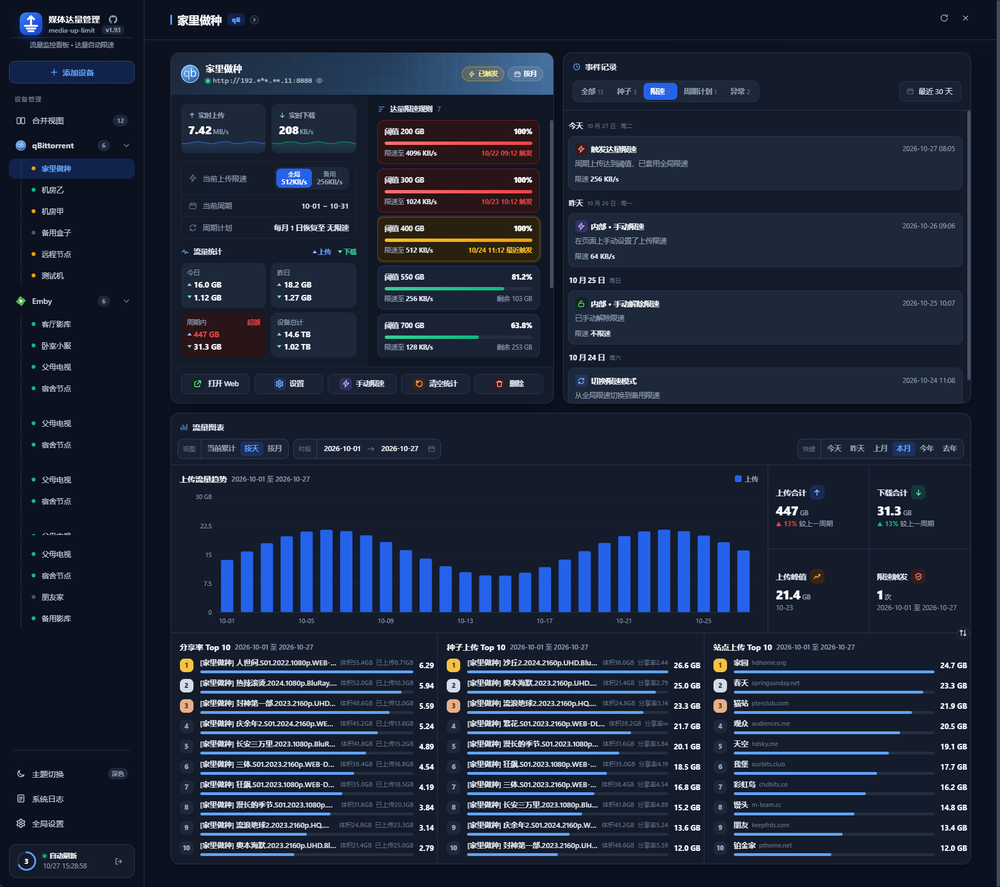
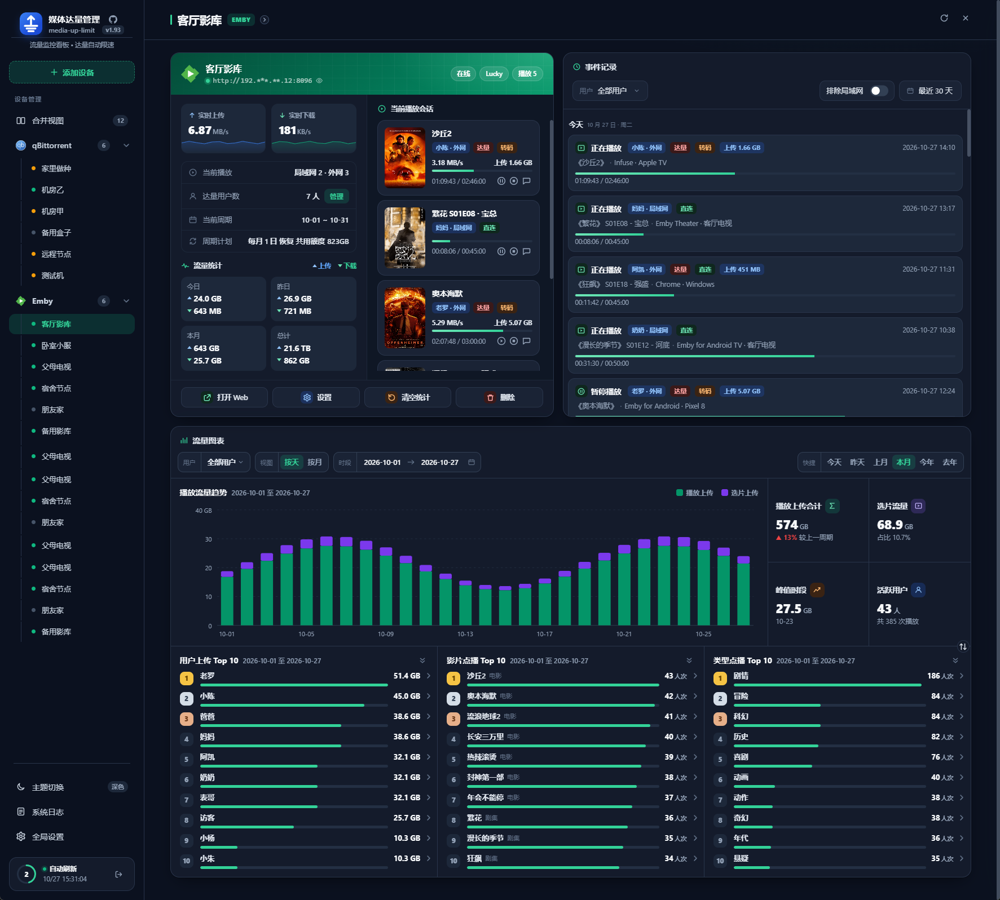
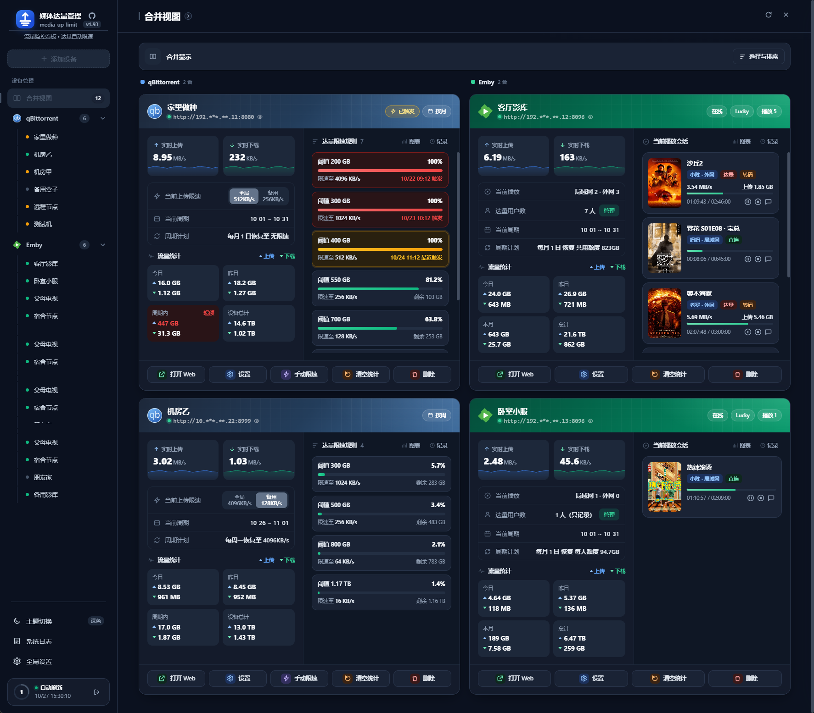

# 媒体达量管理

[](https://github.com/luowenfu/media-up-limit/releases)
[](https://hub.docker.com/r/luowenfu/media-up-limit)

**qBittorrent 达量限速**——qB 上传到达阀值后自动限速，支持多周期；支持多级达量规则。

**Emby 达量停播** ——上传到达指定阀值后自动停播，支持多周期；支持共用额度、每人额度、独立额度管理。

---

## 「qBittorrent 达量限速」



- 多台 qB 按月、周或天统计上传，到量自动降速，下个周期自动恢复
- 多档规则逐级生效，用得越多限得越狠
- 随时手动限速、解除，或切换备用速度
- 实时看上传、下载和在线状态，有流量图表、种子排行和事件记录

### 怎么用

1. 在「设备」里添加 qB 的地址、用户名和密码，确认显示在线
2. 在规则里选周期，填达量值和对应限速，可加多档，例如 300GB 限 2MB/s、500GB 限 512KB/s
3. 保存即可。到量自动限速，周期切换自动恢复

需要 qB 开启 WebUI，容器能访问到 qB，程序持续运行（停机期间不统计）。

> **内部覆盖**：在本页面手动限速或解除，规则行显示「内部覆盖」
>
> **外部覆盖**：直接在 qB 里改了全局限速，会识别为「外部覆盖」，不会立刻改回
>
> 两种覆盖只管当前档。用量到达更高一档时，规则重新接管

### 注意

- 改的是 qB 的全局上传限速。不影响qB的「备用速度限制」执行。
- qB 离线期间不统计、不改限速，恢复在线后按当前用量重新判定


---

## 「Emby 达量停播」



- 实时看播放会话，区分局域网和外网，外网 IP 默认打码
- 经 Lucky 反代，按Emby的「用户」统计外网的上传流量
- 用户用完额度后再开播，会弹出提示并停止播放
- 有播放和选片记录、活动日志、用户和影片排行、流量图表

先在「设置 › 系统」打开「Emby 监控」，再添加 Emby 设备。

### 流量采集

- **不开采集**：只显示播放会话，不进行统计流量
- **Lucky 反代模式**：用 Lucky 反代的连接流量，归属到 Emby 用户和会话，统计外网播放和选片流量
- 浏览海报、选片产生的流量记为「选片流量」，可选是否计入用户额度
- 流量按十进制统计（1 GB = 1000 MB）。Emby 与本程序要在同一时区
- 播放记录保留 90 天

### 达量停播

需要先开 Lucky 反代模式。

- **额度**：共用额度或每人额度，也可给单个用户设独立额度（优先）。填 0 不限
- **判定**：只在开播时判定一次。播到一半超额不打断，下次开播再拦
- **停播**：先弹提示并暂停，5 秒后停止。没停下会隔 30 秒再来一轮
- **提示**：弹窗或轻提示，文案可自定义，`{when}` 会换成额度恢复时间
- **不拦**：局域网播放、程序启动时已在播的会话、读取用量失败时
- **默认只记录不执行**：确认无误后，在 Emby 设置里关闭「只记录不执行」
- **条件**：API 密钥能读用户和会话、能发命令；客户端支持远程遥控；不用装插件

## 合并视图



qB 和 Emby 放在一页看。

## 快速开始

```yaml
services:
  media-up-limit:
    image: luowenfu/media-up-limit:latest
    container_name: media-up-limit
    restart: unless-stopped
    network_mode: host
    environment:
      TZ: Asia/Shanghai
    volumes:
      - ./data:/data
```

也可以用 `ghcr.io/luowenfu/media-up-limit:latest`。

启动后打开 `http://<主机IP>:8765`。首次先设账号，设完自动登录。设备和设置都在页面里改。

手机也能用，支持深浅色主题，系统日志可在页面里查看和导出。

## 设置

- **刷新间隔**：1 到 10 秒，采集间隔随之自动调整
- **时区**：影响周期切换和统计的日期边界
- **Web 端口**：默认 8765，修改后需重启
- **数据保存**：1 到 20 年，默认 5 年，超出自动清理
- **默认显示**：电脑和手机分别选打开时进入哪个页面
- **历史数据**：已删除设备留下的数据，可查看、导出或清理
- **登录**：修改账号和密码，密码至少 6 位

## 环境变量

| 变量 | 说明 |
| --- | --- |
| `TZ` | 容器时区，例如 `Asia/Shanghai` |
| `TRUSTED_PROXY_COUNT` | 前面有几层公网反代就填几，例如 Cloudflare 填 `1`；填 `0` 不信任转发头；不填时只信任局域网反代 |
| `SESSION_COOKIE_SECURE` | 只走 HTTPS 访问时填 `true`，登录 Cookie 只经 HTTPS 发送 |
| `APP_LOG_LEVEL` | 日志级别，默认 `INFO` |
| `CORS_ORIGINS` | 允许跨域访问的来源，多个用逗号分隔，默认不开 |

## 从旧版升级

从旧镜像 `luowenfu/qb-up-limit` 升级时，只改镜像名，数据目录不用动。已保存的 qB、Emby、Lucky 连接会在下次启动时自动改封，不用重填。

## 不要公开这些文件

密码和密钥加密存放在 `data/`，登录失败过多会限流。下面这些文件不要外传：

- `data/config.yaml`
- `data/.qb_secrets`、`data/.emby_secrets`
- `data/.web_auth`、`data/.web_secret`、`data/.data_key`
- `data/*.db`、`data/app.log*`、`data/emby_events/`

本项目仅供学习测试。

## 兼容性

本项目在以下版本上开发并测试：**qBittorrent 5.1.4**、**Emby Server 4.7.14**、**Lucky 2.27.2**。

其他版本如遇问题，请在 Issue 中附上各组件版本号反馈。若你已在其他版本上验证可正常使用，也欢迎在 Issue / 讨论里说明具体版本，便于汇总兼容情况。

### qBittorrent

| 版本 | 状态 | 说明 |
| --- | --- | --- |
| 5.1.4 | 已验证 | 开发基线 |
| 5.1.x 其他小版本 | 预期兼容 | 同一分支，WebAPI 未见相关改动 |
| 5.0.x | 未验证 | API 应当可用，尚未测试 |
| 5.2.0 – 5.2.2 | 需验证（有风险） | 登录 Cookie 变更，旧客户端可能登不上 |
| 4.x 及更早 | 未验证 | 不建议声明支持 |

### Emby

| 版本 | 状态 | 说明 |
| --- | --- | --- |
| 4.7.14 | 已验证 | 开发基线 |
| 4.8.x | 预期兼容 | `/Sessions` 等所用接口仍在 |
| 4.9.x | 预期兼容，建议实机测试 | 发布说明未见 Sessions 相关破坏性变更 |
| Jellyfin | 未验证 | 不在支持范围内 |

### Lucky

| 版本 | 状态 | 说明 |
| --- | --- | --- |
| 2.27.2 | 已验证 | 开发基线 |
| 2.2x 其他版本 | 未验证 | 接口应当相同，尚未测试 |
| 3.0.x | 未验证 | 公开日志未见 `accessdetail` / `openToken` 变更 |
| 3.1.0 – 3.4.x | 需实机验证 | 3.1.0 重构了 Web 服务与反代，规则结构可能受影响 |
## 许可证

[MIT](LICENSE)

## 致谢

- [qbittorrent-api](https://github.com/rmartin16/qbittorrent-api)
- [Flask](https://flask.palletsprojects.com/)
